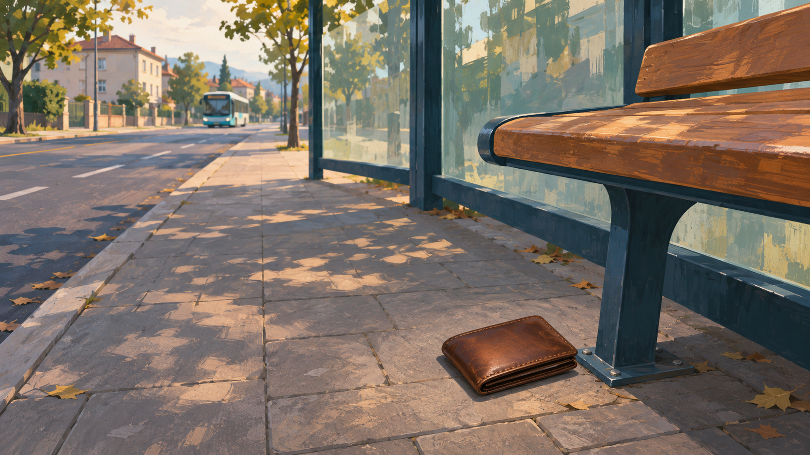

# Pénztárca – nyitójelenet, illusztrációs próba

**Státusz:** jóváhagyásra szánt stílusminta; nincs beépítve a játék képernyőibe.

Egyetlen, képgenerálással készített PNG (1672 × 941 képpont). A kép késő délutáni buszmegállót mutat a helyzetet észrevevő diák nézőpontjából, a pad mellett heverő barna pénztárcával. A játék működése és meglévő illusztrációi ebben a körben változatlanok.

## Kipróbált grafikai irány

- Stilizált, digitálisan festett jelenet, látható festői textúrával és áttekinthető formákkal.
- Meleg délutáni fény, sötétkék szerkezeti elemek, visszafogott türkiz és természetes barna színek, a tananyagcsalád arculatához kapcsolva.
- Első személyű nézőpont; a főszereplő arca és neme nem jelenik meg.
- Nincs felirat, logó, erkölcsi minősítés vagy a döntés irányába mutató jelzés.
- Nyugodt, életszerű környezet, a felfedezésből adódó enyhe feszültséggel.

A generálás leírása egy zárt barna pénztárcát kért a buszmegálló padja mellé, enyhén lefelé néző kompozícióval, távolban közeledő busszal, festett grafikai stílusban. A fő színreferenciák: `#052738`, `#31B6C7`, `#FBF9F6`. A minta nem fotó vagy SVG-helyettesítés.

A további képek, az alkalmazásba építés és a jelenet különböző képernyőkön történő felhasználása a jóváhagyást követő külön fejlesztési kör feladata.
